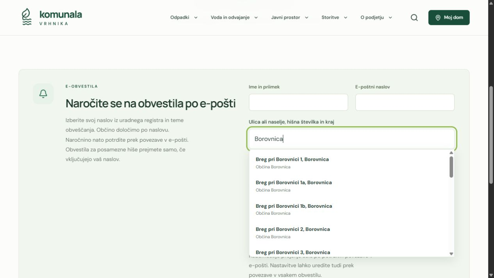

# Verified addresses and final audit release — 3 November 2026

This release implements the owner's approved official-house selection for subscriptions and collection, automatic municipality assignment, exact-house targeting regressions, mail lease/privacy race protection, malformed CSRF rejection, and admin draft/history corrections. The coordinated [address audit](FINAL-ADDRESS-AUDIT-2026-11-03.md), [security audit](FINAL-SECURITY-AUDIT-2026-11-02.md), [functions review](FINAL-FUNCTIONS-AUDIT-2026-11-02.md) and [UI report](VERIFIED-ADDRESS-UI-2026-11-03.md) record the evidence and practical limits.

The [production test-data reset](LAUNCH-CLEANUP-2026-11-03.md) completed separately from code deployment. Old operational records, subscribers, campaigns, test notices, private photos, drafts and restore history are gone; current reference configuration and the owner account remain.

Final pre-release checks: **196 server/shared + 193 UI = 389 passing tests**, TypeScript, production build, clean diff check and Wrangler dry-run. Local startup profiling completed successfully (about 198 ms on this machine; not an edge timing claim). The register is bundled server-side, not shipped in the browser bundle or queried through an external geocoder during typing.

Actual local-browser checks covered verified keyboard/mouse address selection, saved-home/full-schedule handoff, complete and partial schedules, automatic municipality, signup through captured confirmation to management/address change/reload/unsubscribe, genuine local owner authentication, clean work queue, normalized private draft save and settings history. Responsive subscription picker/admin queue checks at 390 px showed no horizontal overflow. No production synthetic submission, test email or campaign was created.

## Remaining operational requirement

The [full-register coverage diagnostic](ADDRESS-COVERAGE-DIAGNOSTIC-2026-11-03.md) found all 6,795 canonical houses resolvable, but only 1,924 with three unambiguous future fractions under current published route rules. There are 2,141 houses with at least one ambiguous fraction and 195 with no candidate. These are configuration diagnostics, not proof of service entitlement or geography. KPV must supply/verify house-to-route and ordinary/small-vehicle assignments, service eligibility and dates. The application shows partial/unresolved guidance and official contacts instead of invented assignments.

New notification subscriptions derive one of the three municipality IDs. Existing custom-area memberships are retained as flat legacy groups; updated admin guidance explains that new households are not enrolled in those groups. The owner subsequently chose municipalities plus explicit street/house targeting, as recorded below.

Native calendar provider acceptance, physical-device GPS/camera/printing, assistive-technology speech and real operator/resident usability are not certified by automated/component or desktop-browser tests. The completed checks support the released code; they are not a guarantee that every possible device, workflow or future operational input is bug-free.

## Deployment and independent follow-up

Initial application commit `29a95202837616b218361fad53688501871ef4a1` was pushed to `codex/admin-workflows` and deployed as Worker `fb15c84f-d834-401d-ace4-b252d3e0f88f`. Push CI `41586045646` and PR CI `41586051020` succeeded. Cloudflare reported 205 ms startup. No schema migration was needed.

Production smoke passed: D1-backed calendar/collection, protected submissions/uploads and cross-origin rejection. No positive market enquiry was attempted because no future date is published. Sixteen additional live HTTP checks verified all three official municipalities, local search, unknown addresses, malformed query limits, duplicate queries, forged ID/address pair rejection, complete/partial schedules, unauthenticated private-data rejection, empty current notices/market and exact deployed JavaScript bundle SHA-256 equality. A fresh cleanup verification still found all 27 operational/history tables empty with the owner/configuration preserved. R2 listing remained empty, managed public exposure disabled and custom domains empty.

The actual deployed browser verified keyboard address selection and automatic municipality, home address save with all three next fractions, full schedule handoff, individual calendar selection and a future Google calendar subscription link. Calendar account acceptance was not submitted. The agent's earlier saved test address was removed through the public forget control. No remote subscriber, campaign or operational test record was added.

The independent post-deployment reviewer found two further UX defects: searching a municipality could prioritize addresses matched only through a postal locality in another municipality, and no-route guidance asked residents to re-enter a house already verified. Both were reproduced with failing regressions and corrected. Visible canonical matches now precede postal-only aliases, which remain searchable; missing-route guidance describes the published boundary gap and provides the official schedule/phone. The follow-up full server/shared suite passed **197 tests**; the unchanged UI suite remains **193 passing tests**, giving **390** in total. Wrangler dry-run passed for the follow-up.

The final application commit **`95ab94dfb2914eda42d61bf7bd608117a29514b3`** was pushed and deployed as Worker **`11e6b91a-400e-43fc-9803-acab37603045`**. Push CI **`41586511311`** and PR CI **`41586516244`** succeeded. The post-follow-up live smoke passed again; **19** read-only HTTP checks now include actual Borovnica result ranking and the clearer missing-route error from both collection and calendar endpoints. Exact deployed bundle equality and the empty operational-data/configuration checks still passed.

## Approved municipality targeting follow-up

The owner selected municipality grouping plus street/house restrictions instead of a new saved-house-group model. The unused **Dodaj območje obveščanja** action has been removed. Existing municipality/custom area records, editing/activation controls, subscriber memberships and exact-street/house delivery rules are preserved; no production content or subscriber mutation is needed. The description field now says **Opis območja za urednike**, so it is not mistaken for an automatic address-assignment rule. Collection route creation remains a separate, useful function and is unchanged.

The existing targeted admin operations and exact-house editor suites passed **14 tests**; TypeScript, production build and Wrangler dry-run passed. Genuine isolated-owner sign-in and browser inspection confirmed zero add-area buttons, three preserved municipality names and description fields, and the corrected section guidance. No content was published or production data changed during this check. The admin screenshot below is from that isolated preview.

Application commit **`f8ac7b09f8dd92c4bd2337b62101f5b634ea21c9`** was pushed and deployed as Worker **`a35cac17-5fcd-45d0-9197-fc60e131bfa0`**. Push CI **`41668744855`** and PR CI **`41668755889`** both succeeded, including the full build/test/dry-run workflow. The live admin JavaScript bundle matched the local build by SHA-256, contained the new guidance/description label and omitted the removed action; the public content still exposed the same three municipality IDs. Live smoke passed, with market enquiry correctly skipped while no future date is published. No database migration, existing-area deletion or notification dispatch was performed.
